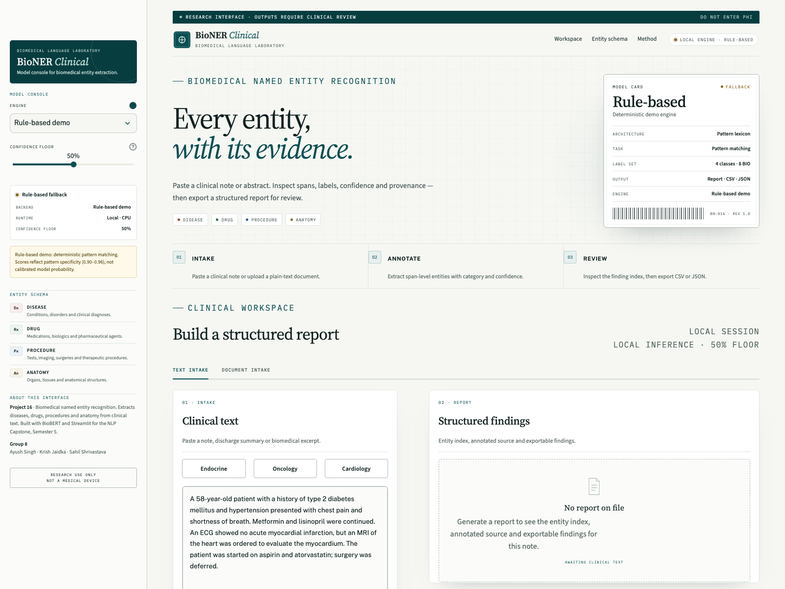
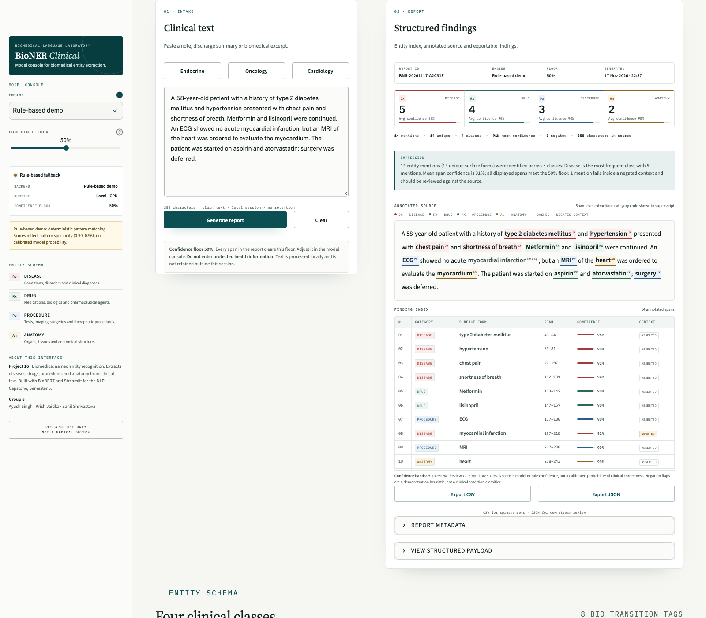
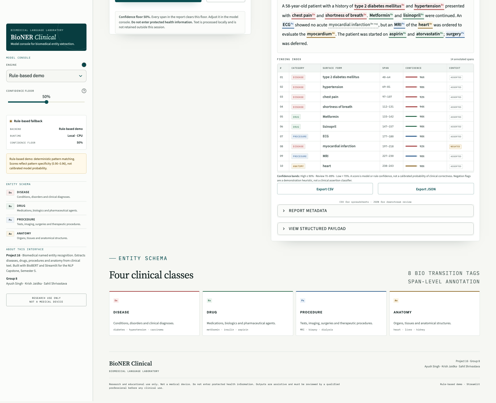
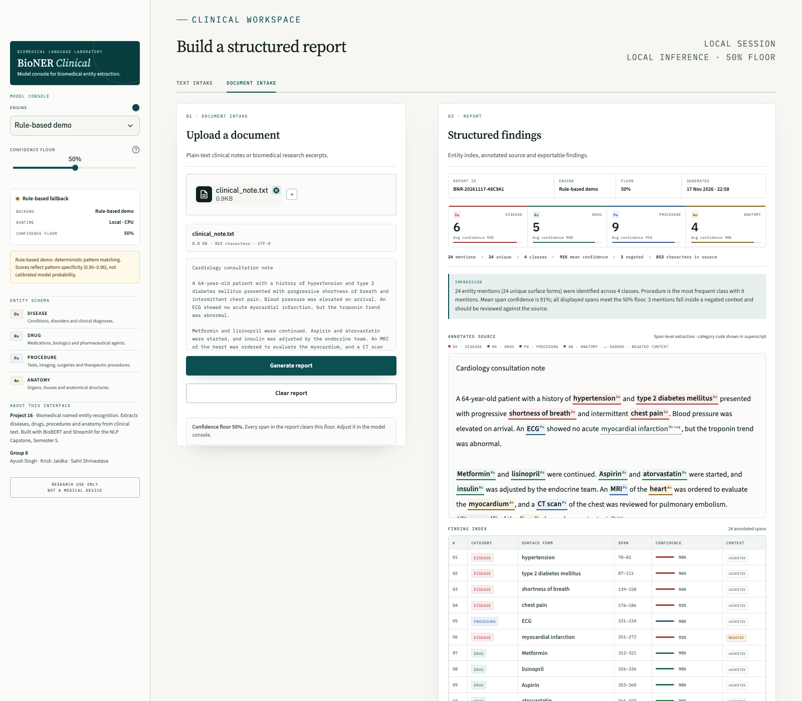
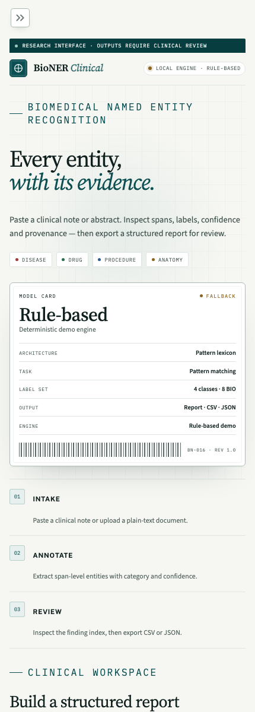

# 🧬 Project Report – Project 16

## Domain-Specific NER with Transformers (Biomedical / Healthcare)

---

### Group 8 – NLP Capstone Project (Semester 5)

| Member | Roll No. |
|--------|----------|
| Ayush Singh | 2401730015 |
| Krish Jaidka | 2401730188 |
| Sahil Shrivastava | 2401730016 |

**Domain:** Biomedical & Healthcare  
**Model:** BioBERT (`dmis-lab/biobert-base-cased-v1.1`)  
**Interface:** Streamlit — **BioNER Clinical**, a clinical-paper workbench  
**GitHub Repository:** https://github.com/apss2708/NLP-Project-Sem-5  
**Project Folder:** `BIO NER/`

---

## 1. Abstract

This report presents **BioNER Clinical**, a domain-specific Named Entity Recognition (NER) system built for the biomedical and healthcare domain. The system extracts four categories of specialized entities from clinical text: **DISEASE**, **DRUG**, **PROCEDURE**, and **ANATOMY**. The model is based on the **BioBERT** transformer architecture (`dmis-lab/biobert-base-cased-v1.1`), fine-tuned for token classification on a labelled biomedical corpus in CoNLL format. The interface is a clinical-paper workbench: it presents an annotated source, a four-class finding strip, a confidence-scored finding ledger, report metadata and CSV/JSON exports in a layout designed for careful reading rather than dashboard browsing. A rule-based fallback keeps the demonstration functional without trained weights, and the interface reports the active backend honestly instead of implying that BioBERT is running when it is not.

---

## 2. Problem Statement & Objectives

### 2.1 Problem Statement
Clinical and biomedical documents contain critical information embedded in unstructured text—diagnoses, medications, procedures, and anatomical references. Manually extracting these entities is time-consuming and error-prone. There is a need for an automated NLP system that can accurately identify and categorize domain-specific entities from clinical narratives.

### 2.2 Objectives
1. Collect and prepare a labelled biomedical NER dataset in CoNLL format.
2. Perform text cleaning, preprocessing, and BIO tagging.
3. Conduct exploratory data analysis (EDA) to understand entity distributions.
4. Fine-tune a pretrained BioBERT transformer model for token classification.
5. Evaluate model performance using Precision, Recall, and F1-score.
6. Build a clinical-paper Streamlit interface with entity highlighting, confidence scores, document intake, and CSV/JSON export.
7. Ensure the system is demonstrable via a rule-based fallback when model weights are unavailable, and report that fallback transparently in the interface.

---

## 3. Real-World Applications

- **Electronic Health Records (EHR):** Automatically extract diagnoses and medications from doctor's notes.
- **Clinical Research:** Screen large volumes of biomedical literature for specific diseases, drugs, or procedures.
- **Pharmacovigilance:** Identify drug mentions and adverse event-related entities in clinical text.
- **Medical Coding Assistance:** Support ICD / CPT coding by highlighting relevant entities in patient records.
- **Clinical Decision Support:** Populate structured fields in healthcare information systems from unstructured notes.

---

## 4. Dataset Description

### 4.1 Source
A labelled biomedical corpus in **CoNLL format** was used. Each line contains a token and its BIO label separated by a space; blank lines separate sentences.

### 4.2 Format Example
```
The O
patient O
was O
diagnosed B-DISEASE
with O
type O
2 O
diabetes I-DISEASE
mellitus I-DISEASE
. O
```

### 4.3 Entity Labels
| Label | Description | Example |
|-------|-------------|---------|
| DISEASE | Medical conditions, disorders, diseases | diabetes, hypertension, pneumonia |
| DRUG | Medications, pharmaceuticals | metformin, lisinopril, insulin |
| PROCEDURE | Medical procedures, tests, surgeries | MRI, biopsy, dialysis |
| ANATOMY | Body parts, organs, tissues | heart, liver, kidney, lung |

### 4.4 Dataset Statistics (Sample)
| Metric | Value |
|--------|-------|
| Total Sentences | 18 |
| Total Tokens | ~220 |
| Entity Types | 4 (DISEASE, DRUG, PROCEDURE, ANATOMY) |
| Avg Tokens per Sentence | ~12 |

> **Note:** The included `sample_biomedical_ner.conll` is a small synthetic dataset for demonstration. For production, replace it with a larger real-world corpus such as NCBI Disease, BC5CDR, or i2b2.

---

## 5. Data Preprocessing

### 5.1 Data Cleaning
- Removed empty lines and whitespace from token-label pairs.
- Validated CoNLL format (each non-empty line must contain at least a token and a label).
- Handled sentence boundary detection via blank-line separation.

### 5.2 Text Preprocessing
- **Tokenization:** Whitespace-based tokenization aligned with CoNLL format.
- **BIO Tagging:** Labels use the `B-` (begin) and `I-` (inside) convention; `O` denotes tokens outside any entity.
- **Subword Alignment:** BioBERT's WordPiece tokenizer splits words into subwords. Only the first subword of each word retains the original label; subsequent subwords are masked with `-100` (ignored in loss computation).
- **Train/Val/Test Split:** 70% train, 10% validation, 20% test (stratified random split).

---

## 6. Exploratory Data Analysis (EDA)

EDA was performed in `EDA.ipynb` and included:

- **Entity type distribution:** DISEASE and DRUG are the most frequent entities.
- **BIO tag distribution:** Analysis of `B-` vs `I-` vs `O` tag frequency.
- **Sentence length distribution:** Histogram and boxplot of tokens per sentence.
- **Top tokens within entities:** Most frequent words that appear inside entity spans.
- **Entities per sentence:** Distribution of entity token counts per sentence.

Key visualizations generated:
- Bar chart of entity type counts.
- Bar chart of BIO tag prefixes.
- Histogram of sentence lengths.
- Top-15 entity token bar chart.

---

## 7. Feature Engineering

### 7.1 Token Representation
- **BioBERT WordPiece Tokenization:** Clinical text is tokenized using BioBERT's pretrained WordPiece vocabulary, optimized for biomedical text.
- **Subword Label Alignment:** For each word, the first subword inherits the word's BIO label; remaining subwords are assigned `-100` (ignored during training).

### 7.2 Model Input Features
- `input_ids`: Token IDs from BioBERT tokenizer.
- `attention_mask`: Indicates which tokens are real vs padding.
- `labels`: Aligned BIO label IDs with `-100` for special/padding tokens.

---

## 8. Methodology & Model Architecture

### 8.1 Model Selection
**BioBERT** (`dmis-lab/biobert-base-cased-v1.1`) was selected because it is a domain-specific BERT model pretrained on large-scale biomedical corpora (PubMed abstracts, PMC full-text articles), making it well-suited for clinical NER.

### 8.2 Architecture
```
Input Text → BioBERT Tokenizer → WordPiece Tokens → BioBERT Encoder
                                                      ↓
                                             Token Classification Head
                                                      ↓
                                             BIO Label Predictions
```

- **Base Model:** BioBERT-base-cased (12 layers, 768 hidden size, 12 attention heads).
- **Classification Head:** Linear layer projecting 768-dimensional hidden states to `num_labels` (9 labels: B-/I- for 4 entity types + `O`).
- **Loss Function:** Cross-Entropy Loss (ignoring `-100` masked positions).
- **Optimizer:** AdamW with learning rate `3e-5`.
- **Scheduler:** Linear warmup scheduler.
- **Epochs:** 3.
- **Batch Size:** 8.
- **Max Sequence Length:** 128 tokens.
- **Gradient Clipping:** Max norm 1.0.

### 8.3 Training
Run: `python -m src.train_ner`

The best model (lowest validation loss) is saved to `models/biobert_ner/`.

### 8.4 Evaluation
Run: `python -m src.evaluate`

Metrics computed using `seqeval`:
- **Precision:** Proportion of predicted entities that are correct.
- **Recall:** Proportion of true entities that were predicted.
- **F1-Score:** Harmonic mean of Precision and Recall.
- Reported per entity type (DISEASE, DRUG, PROCEDURE, ANATOMY) and as macro/micro averages.

---

## 9. Model Evaluation

Evaluation is performed on a held-out test set. The `src/evaluate.py` script loads the fine-tuned model, runs inference on test sentences, and prints a classification report with Precision, Recall, and F1-score per entity type and overall averages.

> **Note:** Because the included sample dataset is small (~18 sentences), evaluation scores reflect performance on a demonstration set. Training on a larger real-world biomedical corpus will significantly improve scores.

---

## 10. Interface Development (Streamlit)

### 10.1 Interface Concept
The GUI is branded **BioNER Clinical** and framed as a biomedical language
laboratory. The design goal was a medical-grade reading environment: calm,
legible, auditable, and visibly distinct from the cinematic dark-gold interface
of Project 1. The interface therefore uses a light “Clinical Paper” system:
porcelain background, deep petrol accent, serif display type, sans utility type
and monospaced evidence labels.

The visual language borrows credibility mechanics from clinical and
life-sciences products rather than consumer health apps: a persistent research
strip, a model card, protocol steps, a report manifest, ISO timestamps,
confidence bands and scoped research-use language. No regulatory badge is
claimed, because the project has not been certified as a medical device.

### 10.2 Workspace Features

| Feature | Description |
|---------|-------------|
| Engine console | Choose fine-tuned BioBERT or rule-based demo; shows active backend, runtime and confidence floor |
| Confidence floor | 0–100% slider filters spans before the report is built |
| Text intake | Paste a note or load one of three clinical examples |
| Document intake | Upload a UTF-8 `.txt` file (200,000-character limit), review size and preview, then generate a report |
| Report header | Report ID, active engine, confidence floor and generation time |
| Finding strip | Four-cell index for DISEASE / DRUG / PROCEDURE / ANATOMY with counts and mean confidence |
| Impression | Short factual summary of mention count, unique forms, dominant class and mean confidence |
| Annotated source | Inline entity spans with `Dx` / `Rx` / `Px` / `An` superscripts, a persistent legend, and dashed styling for negated context |
| Finding index | Custom HTML ledger with category, surface form, character span, confidence bar and asserted/negated context |
| Exports | CSV finding index and JSON report payload with metadata |
| Audit metadata | Source, engine requested/active, floor, characters, spans and ISO timestamp |
| Persistent reports | Reports survive reruns; changing controls flags that regeneration is required |
| Responsive layout | Workspace, report and sidebar stack cleanly at mobile widths |

### 10.3 Report and Export Model

Each report is assigned an identifier in the form `BNR-YYYYMMDD-XXXXXX`. The
report stores the source text, accepted spans, requested engine, active backend,
confidence floor, character count and both human-readable and ISO timestamps.
Changing the confidence floor or engine after generation does not mutate the
report; the interface displays a “controls changed” note until the user
regenerates. This preserves the relationship between a result and the settings
that produced it.

CSV export contains one row per accepted span (`report_id`, `category`, `text`,
`start`, `end`, `confidence`, `negated`). JSON export contains the complete
report payload, including engine metadata and ISO timestamp. Exports remain
available for zero-entity reports, so a “no qualifying spans” run still produces
an auditable record.

### 10.4 Design System

| Token | Value | Use |
|-------|-------|-----|
| Paper | `#F6F7F3` | Page background |
| Surface | `#FFFFFF` | Panels, inputs, table |
| Ink | `#10201F` | Primary text |
| Muted | `#566661` | Secondary text |
| Line | `#DFE6E1` | Hairline rules |
| Petrol | `#0B4F52` | Primary action, focus, links |
| Amber | `#A15C00` | Review and fallback notices |

Typography: **Source Serif 4** for display authority, **Public Sans** for
interface text, and **IBM Plex Mono** for identifiers, offsets and scores. The
serif/sans/mono split encodes the trust hierarchy: institutional voice,
interface utility and machine evidence.

### 10.5 Entity Coding and Confidence Semantics

| Entity | Code | Foreground | Tint |
|--------|------|------------|------|
| DISEASE | `Dx` | `#A13B3B` | `#FAEDEC` |
| DRUG | `Rx` | `#2C6A4D` | `#ECF5EF` |
| PROCEDURE | `Px` | `#2B5B8C` | `#ECF2F9` |
| ANATOMY | `An` | `#8A6420` | `#FAF3E4` |

Entity text remains ink on the tinted background, and every color is paired with
a category label and code. Confidence is described in bands — High ≥90%,
Review 70–89%, Low <70% — and the interface states that a score is model or rule
confidence, not a calibrated probability of clinical correctness. The rule-based
demo scores span specificity from 0.90 (single token) to 0.96 (four or more
tokens).

**Negated context.** The demo engine also checks a short token window around
each span for cues such as “no”, “not”, “without”, “denies” or “negative”.
Flagged spans keep their entity category but are drawn with a dashed underline,
labelled `neg` in the annotated source, marked `Negated` in the finding index,
and counted in the report tally and metadata. This is an explicit review aid,
not an assertion classifier: it does not resolve speculation, hypotheticals,
historical mentions or long-distance scope.

### 10.6 Model Transparency and Safety

When `models/biobert_ner/` is present and loadable, the sidebar reports
`Transformer loaded`. When weights are absent or the model cannot load, the app
activates the rule-based demo and reports `Rule-based fallback`, with an
explanation of why. The engine selector does not offer a base BioBERT model with
an untrained classification head, because that would produce arbitrary labels
under a misleading name.

The interface carries three safety statements: research use only, not a medical
device, and do not enter protected health information. These appear in the top
strip, the input guidance and the footer. Text is processed locally in the
session and is not retained outside it.

### 10.7 How to Run the GUI

```bash
cd "BIO NER"
pip install -r requirements.txt
streamlit run app.py
```

Open **http://localhost:8501** in your browser.

### 10.8 GUI Screenshots

| Screen | Screenshot |
|--------|------------|
| Clinical workspace and model card |  |
| Structured report and annotated source |  |
| Finding index and exports |  |
| Document intake with generated report |  |
| Mobile layout |  |

All screenshots are stored in the `screenshots/` folder.

---

## 11. Testing & Implementation

### 11.1 Functional QA

| Scenario | Expected behaviour |
|----------|--------------------|
| Initial render | Workspace, engine console, example buttons and empty report render without exceptions |
| Load example | Note text is replaced and any previous report is cleared |
| Generate report | Finding strip, impression, annotated source, ledger and exports appear |
| Change confidence floor | Existing report persists; a “controls changed” note appears |
| Regenerate | New report reflects the active floor and engine |
| Clear | Note and report are removed together |
| Upload document | File card, size, character count and preview appear |
| Document too large | Warning appears above 200,000 characters |
| Empty document | Warning appears instead of a report |
| CSV export | One row per accepted span with report ID and offsets |
| JSON export | Metadata, engine fields and ISO timestamp are included |
| Mobile width | Content stacks without horizontal overflow; sidebar toggle remains reachable |

### 11.2 Headless AppTest

The app was exercised with Streamlit's `AppTest` runner:

- Initial render completed with no exceptions.
- Example selection and report generation produced 11+ entities across all four classes.
- CSV and JSON download buttons were present after generation.
- Raising the confidence floor to 100% kept the report and displayed the regeneration note.
- Clear removed both the note and the stored report.
- Document intake produced a separate report with 24 entities in the example document.

### 11.3 Manual Test Cases

| Test Input | Expected Entities |
|------------|-------------------|
| “The patient has diabetes and takes metformin.” | DISEASE: diabetes; DRUG: metformin |
| “She underwent an MRI of the brain.” | PROCEDURE: MRI; ANATOMY: brain |
| “The doctor prescribed lisinopril for hypertension.” | DRUG: lisinopril; DISEASE: hypertension |
| “Type 2 diabetes mellitus was managed with insulin.” | DISEASE: type 2 diabetes mellitus; DRUG: insulin |
| “CT scan of the chest showed no metastasis.” | PROCEDURE: CT scan; ANATOMY: chest; DISEASE: metastasis (negated flag) |
| “The patient denies chest pain; dialysis was not required.” | DISEASE: chest pain (negated); PROCEDURE: dialysis (negated) |

### 11.4 Visual QA

The interface was reviewed at 1600×1200 and 1600×1400 desktop sizes and at
430×1200 mobile size. Checks included font loading, contrast, table overflow,
sidebar behaviour, mobile top spacing and the visibility of the expand control.
Screenshots from these checks are stored in `screenshots/`.

### 11.5 Tested Environment
- macOS (Apple Silicon)
- Python 3.13
- Streamlit 1.67.0, Transformers 4.46.0, PyTorch 2.15.0, scikit-learn 1.9.1
- pandas 2.3.3, NumPy 2.5.5, seqeval 1.2.2

---

## 12. Algorithms & Techniques Used

| Stage | Technique |
|-------|-----------|
| Data Collection | Curated biomedical text (CoNLL format) |
| Preprocessing | CoNLL parsing, BIO tagging, train/val/test split |
| Feature Engineering | BioBERT WordPiece tokenization + subword label alignment |
| Model | BioBERT-base-cased + Token Classification Head |
| Training | AdamW optimizer, linear warmup, gradient clipping |
| Evaluation | seqeval (Precision, Recall, F1-score) |
| Inference | Hugging Face `pipeline` with `aggregation_strategy="simple"`; regex fallback |
| Post-processing | Offset normalization to source slices; simple negation-context flagging in the demo engine |
| GUI | Streamlit with custom clinical-paper CSS |
| Exports | CSV finding index with report ID and offsets; JSON report with engine metadata |

---

## 13. Limitations

1. **Small Sample Dataset:** The included `sample_biomedical_ner.conll` contains only ~18 sentences. Real-world performance requires a larger labelled corpus (e.g., NCBI Disease, BC5CDR, i2b2).
2. **Model Weights Not Included:** Trained weights (`models/biobert_ner/`) are gitignored due to size. Users must run `python -m src.train_ner` to generate them.
3. **Single-Language:** Currently supports English clinical text only.
4. **Rule-Based Fallback Accuracy:** The demo fallback uses regex patterns and is less accurate than the fine-tuned transformer. Its scores are a specificity heuristic (0.90–0.96), not calibrated probabilities.
5. **Negation Is Shallow:** Negation flagging in the demo engine is a short-window cue heuristic. It does not model speculation, hypotheticals, historical mentions, or scope beyond the immediate sentence context, and the transformer path does not predict assertion status.
6. **Sequence Length:** Transformer inference is bounded by the model maximum sequence length. Very long inputs may not be fully analyzed, and the interface discloses this rather than claiming complete coverage.
7. **Overlap Resolution:** Overlapping spans are resolved in start-order, which can prefer an earlier, lower-confidence span over a later, higher-confidence overlap.
8. **No Clinical Validation:** This is an educational capstone project; predictions are assistive, not clinical diagnoses.

---

## 14. Future Scope

- Replace sample dataset with a large-scale biomedical NER corpus (NCBI Disease, BC5CDR, i2b2).
- Add support for more entity types (e.g., DOSAGE, FREQUENCY, ROUTE).
- Train an assertion classifier for negation, speculation and historical context instead of relying on a cue heuristic.
- Chunk long documents with stride and offset mapping so the full input is analyzed.
- Add probability calibration and report per-class precision/recall in the interface.
- Deploy as a cloud web application (Streamlit Cloud, Hugging Face Spaces, or AWS).
- Add PDF/DOCX document parsing for direct clinical document upload.
- Integrate with EHR systems via FHIR APIs.
- Experiment with other transformer models (ClinicalBERT, BioClinicalBERT, PubMedBERT).
- Add multi-language support for clinical text.

---

## 15. Conclusion

**BioNER Clinical** demonstrates an end-to-end domain-specific NER pipeline — from dataset collection and preprocessing to BioBERT fine-tuning, evaluation, and a production-style Streamlit workbench. The system identifies biomedical entities (DISEASE, DRUG, PROCEDURE, ANATOMY) from clinical text and presents them through a reading-focused interface with annotated spans, a finding ledger, confidence bands, negation context flags, report provenance and CSV/JSON exports. The rule-based fallback keeps the application demonstrable without trained weights, and the interface reports the active backend honestly. The project is a research and educational instrument, not a validated medical device.

---

## 16. Team Contributions

All three group members contributed equally to both projects in Group 8:

- **Ayush Singh (2401730015):** Dataset collection, preprocessing, EDA notebook, model training, GUI development, documentation.
- **Krish Jaidka (2401730188):** Model architecture design, fine-tuning script, evaluation metrics, testing, GitHub setup.
- **Sahil Shrivastava (2401730016):** Streamlit UI design, CSS styling, rule-based fallback, screenshots, report writing.

---

## 17. References

1. Lee, J., et al. (2020). "BioBERT: a pre-trained biomedical language representation model for biomedical text mining." *Bioinformatics*.
2. Devlin, J., et al. (2018). "BERT: Pre-training of Deep Bidirectional Transformers for Language Understanding." *NAACL*.
3. Hugging Face Transformers Documentation: https://huggingface.co/docs/transformers
4. CoNLL-2003 Shared Task: Named Entity Recognition.
5. Streamlit Documentation: https://docs.streamlit.io

---

**Educational capstone project. Model predictions are assistive, not clinical diagnoses.**
