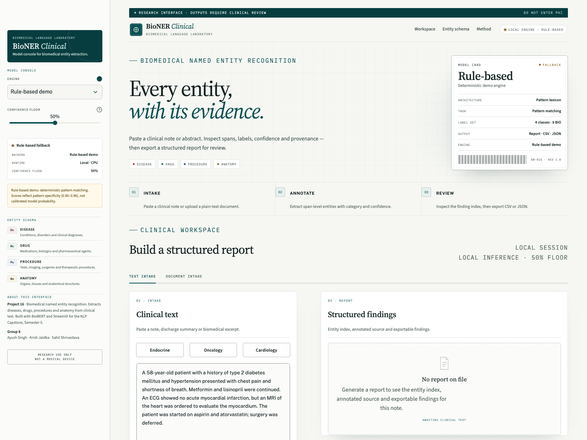
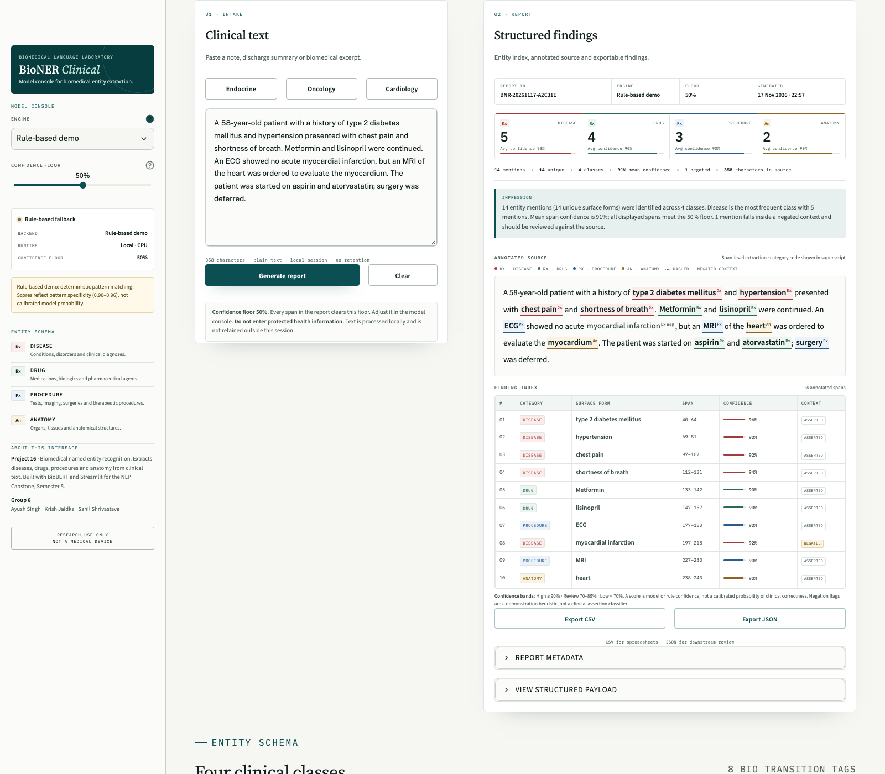
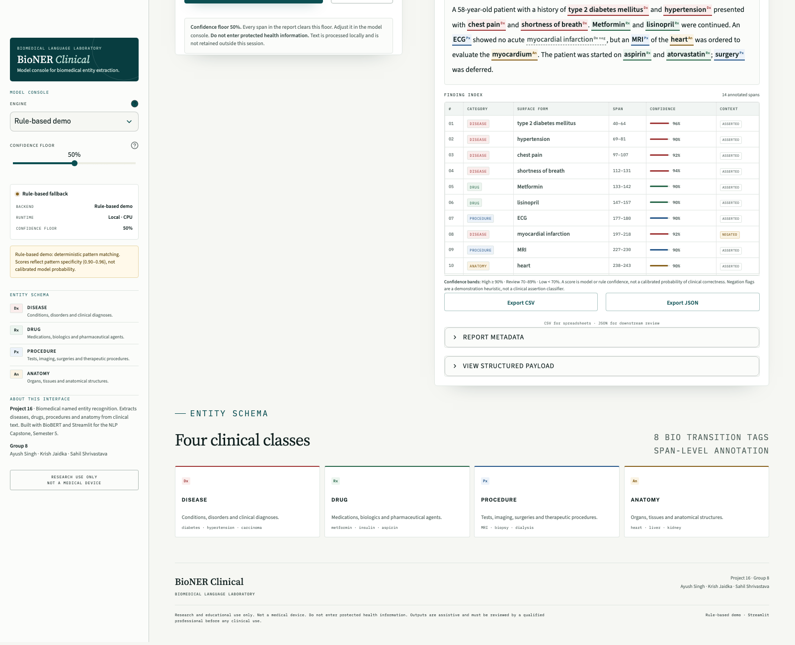
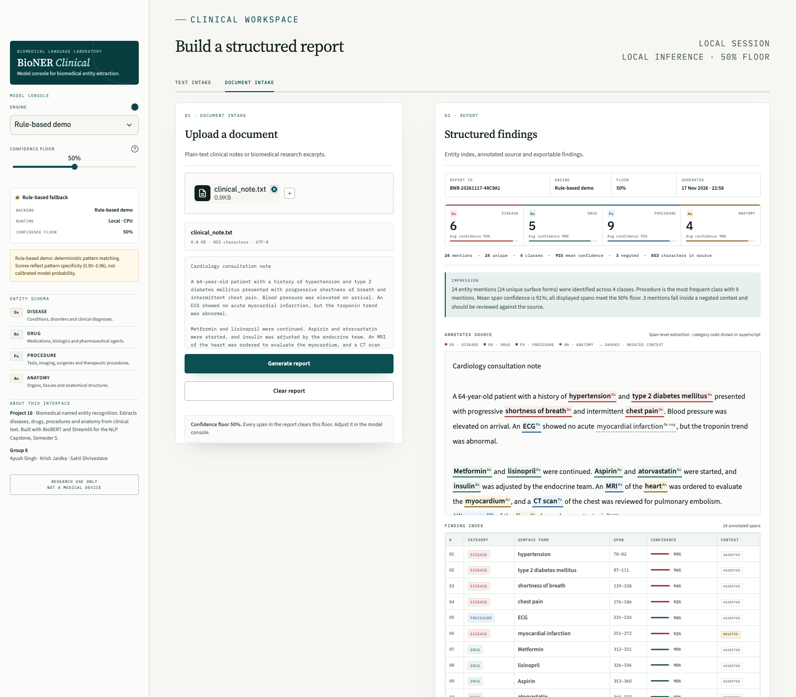
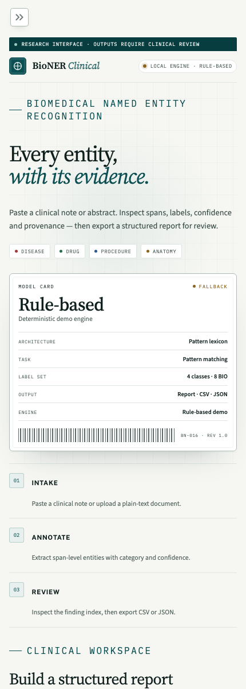

# Project 16 — Domain-Specific NER with Transformers

## BioNER Clinical · Biomedical Language Laboratory

**Group 8**
- Ayush Singh — 2401730015
- Krish Jaidka — 2401730188
- Sahil Shrivastava — 2401730016

**Domain:** Biomedical / Healthcare
**Model:** BioBERT (`dmis-lab/biobert-base-cased-v1.1`) fine-tuned for token classification
**Interface:** Streamlit — **BioNER Clinical**, a clinical-paper workbench
**Repository:** https://github.com/apss2708/NLP-Project-Sem-5

---

## Overview

This project builds a domain-specific Named Entity Recognition (NER) system for
biomedical and clinical text. It extracts four categories of entities —
**DISEASE**, **DRUG**, **PROCEDURE** and **ANATOMY** — with span offsets,
per-entity confidence and a structured, exportable report.

`BioNER Clinical` is designed as a biomedical language laboratory rather than a
generic analytics dashboard: a patient note goes in, an annotated finding index
comes out, and every report carries enough metadata to be audited.

### What the interface does

- **Clinical text intake** — paste a note, discharge summary or abstract, or load
  one of three built-in examples.
- **Document intake** — upload a UTF-8 `.txt` document and review a preview
  before extraction.
- **Engine console** — select the fine-tuned BioBERT engine or the deterministic
  rule-based demo, and set a confidence floor.
- **Structured report** — report ID, engine, floor and generation time are shown
  above the result.
- **Annotated source** — entities are marked inline with category superscripts
  (`Dx`, `Rx`, `Px`, `An`) and a persistent legend. Rule-based spans in a
  negated context use a dashed underline and a `neg` marker.
- **Finding index** — a custom ledger with category, surface form, character
  span, confidence bar and an asserted/negated context chip for every accepted
  span.
- **Exports** — download the finding index as **CSV** or the full report as
  **JSON**.
- **Audit metadata** — view the source, engine requested/active, confidence
  floor, character count, span count and ISO timestamp.
- **Persistent reports** — results survive widget reruns, so exporting or
  changing a control does not erase the report. If controls change, the report
  notes that regeneration is required.
- **Responsive layout** — the workspace, report and sidebar stack cleanly on
  mobile.

### Entity schema

| Label | Code | Description | Examples |
|-------|------|-------------|----------|
| DISEASE | `Dx` | Conditions, disorders and clinical diagnoses | diabetes, hypertension, carcinoma |
| DRUG | `Rx` | Medications, biologics and pharmaceutical agents | metformin, insulin, aspirin |
| PROCEDURE | `Px` | Tests, imaging, surgeries and therapeutic procedures | MRI, biopsy, dialysis |
| ANATOMY | `An` | Organs, tissues and anatomical structures | heart, liver, kidney |

---

## Visual identity — “Clinical Paper”

BioNER Clinical uses a light, paper-based design system built around one petrol
accent. It is intentionally distinct from Project 1's cinematic **Reel Verdict**
interface, so the two submissions read as different products.

| | Project 16 — BioNER Clinical | Project 1 — Reel Verdict |
|---|---|---|
| Mood | Clinical journal / lab instrument | Cinematic editorial / film print |
| Background | Porcelain paper `#F6F7F3` | Near-black print `#0A0908` |
| Accent | Deep petrol `#0B4F52` | Antique gold `#D9B36C` |
| Display type | Source Serif 4 | Instrument Serif |
| UI type | Public Sans | DM Sans |
| Evidence type | IBM Plex Mono | DM Mono |
| Motifs | Instrument strip, model card, protocol steps, finding ledger, audit metadata | Film grain, poster card, ticket stubs, scorecard, critic meters |

### Design tokens

| Token | Value | Use |
|-------|-------|-----|
| Paper | `#F6F7F3` | Page background |
| Surface | `#FFFFFF` | Panels, inputs, tables |
| Ink | `#10201F` | Primary text and headings |
| Muted | `#566661` | Secondary text and captions |
| Line | `#DFE6E1` | Hairline rules and borders |
| Petrol | `#0B4F52` | Primary actions, focus, selected states |
| Amber | `#A15C00` | Review and fallback notices |

Entity tints: DISEASE `#A13B3B` on `#FAEDEC`; DRUG `#2C6A4D` on `#ECF5EF`;
PROCEDURE `#2B5B8C` on `#ECF2F9`; ANATOMY `#8A6420` on `#FAF3E4`. Text stays
ink on tinted backgrounds, and color is always paired with a text label.

The interface is implemented with custom CSS in `app.py`; no external UI kit is
required. All foreground/background pairings are chosen for readable contrast,
and the layout respects reduced-motion preferences.

---

## Screenshots

### Clinical workspace



### Structured report and annotated source



### Finding index and exports



### Document intake



### Mobile layout



---

## Repository structure

```
BIO NER/
├── README.md                      # This file
├── requirements.txt               # Python dependencies
├── app.py                         # Streamlit GUI — BioNER Clinical
├── .streamlit/
│   └── config.toml                # Light clinical theme tokens
├── .gitignore                     # Ignore rules (models/ and raw .conll data)
├── src/
│   ├── __init__.py
│   ├── preprocess.py              # CoNLL loader, splits, NERDataset
│   ├── train_ner.py               # BioBERT fine-tuning script
│   ├── evaluate.py                # Precision / Recall / F1 evaluation
│   └── inference.py               # Transformer pipeline + rule-based fallback
├── data/
│   ├── sample_biomedical_ner.conll # Sample labelled corpus
│   └── README.md                  # Dataset format instructions
├── models/                        # Fine-tuned weights (gitignored — retrain after clone)
├── screenshots/
│   ├── hero.png                   # Workspace and model card
│   ├── report.png                 # Report summary and annotated source
│   ├── findings.png               # Finding ledger and exports
│   ├── document_intake.png        # Upload flow with generated report
│   └── mobile.png                 # Responsive mobile layout
├── EDA.ipynb                      # Exploratory data analysis
└── Project_Report.md              # Full project report
```

---

## Setup and installation

### 1. Clone the repository

```bash
git clone https://github.com/apss2708/NLP-Project-Sem-5.git
cd "NLP Project Sem 5/BIO NER"
```

### 2. Create a virtual environment (recommended)

```bash
python3 -m venv venv
source venv/bin/activate      # Linux / macOS
venv\Scripts\activate         # Windows
```

> On macOS, use `python3` if `python` is not on your PATH.

### 3. Install dependencies

```bash
pip install -r requirements.txt
```

The interface runs immediately without fine-tuned weights: when
`models/biobert_ner/` is absent, the app activates the rule-based demo and says
so in the engine console.

---

## Train the model

```bash
python3 -m src.train_ner
```

This will:

1. Load `data/sample_biomedical_ner.conll`.
2. Split the corpus into train/validation/test sets.
3. Fine-tune BioBERT for token classification.
4. Save the best checkpoint to `models/biobert_ner/`.
5. Print a token-classification report.

> The included dataset is a small demonstration corpus. Replace it with a larger
> labelled corpus (for example NCBI Disease, BC5CDR or i2b2) for meaningful
> performance. Model weights are gitignored because they are large.

---

## Run the interface

```bash
streamlit run app.py
```

Then open **http://localhost:8501**.

### Interface guide

1. **Engine console (sidebar)** — choose `BioBERT · fine-tuned` or
   `Rule-based demo`, set the confidence floor from 0–100%, and read the active
   backend, runtime and floor. The console reports whether the transformer
   loaded or the fallback is active.
2. **Text intake** — load an example or paste a note, then select
   **Generate report**.
3. **Document intake** — upload a `.txt` file (up to 200,000 characters), review
   the file card and preview, then generate a report. The report remains tied to
   the uploaded document so a different file is flagged.
4. **Report** — review the four-class finding strip, the written impression, the
   annotated source, the asserted/negated context flags and the finding index.
5. **Exports** — download CSV for spreadsheets or JSON for downstream review.
   The report metadata and structured payload are available in collapsible
   panels. Exports remain available when a report contains no qualifying spans.

### Report persistence

Reports are stored in session state. Changing the confidence floor or engine
does not silently rewrite a report; the report keeps its original settings and
shows a note that controls changed. Regenerating replaces it. **Clear** removes
the current note and report.

---

## Model behavior and transparency

- **Fine-tuned engine** — active only when `models/biobert_ner/config.json`
  exists. It uses a Hugging Face token-classification pipeline with
  `aggregation_strategy="simple"`.
- **Rule-based demo** — deterministic regex matching over a curated biomedical
  lexicon. It exists so the interface is demonstrable without weights. Scores
  reflect pattern specificity (0.90–0.96), not calibrated model probability.
- **Negation context** — the demo engine flags a span when a negation cue
  appears in a short window inside the same clause. Flagged spans remain in the
  finding index but are marked as negated for review. This is a shallow
  demonstration heuristic, not a clinical assertion classifier; the transformer
  path does not predict negation.
- **No silent fallback** — if the transformer cannot load, the sidebar and header
  report the rule-based backend instead of claiming BioBERT is active.
- **Confidence semantics** — the interface labels bands as High (≥90%), Review
  (70–89%) and Low (<70%), and states that a score is model or rule confidence,
  not a calibrated probability of clinical correctness.
- **Scope** — research and educational use only. Not a medical device. Do not
  enter protected health information. Outputs require review by a qualified
  professional before any clinical use.

---

## Evaluation

After training, run:

```bash
python3 -m src.evaluate
```

The evaluation script reports:

- Precision, Recall and F1-score per entity type.
- Macro and micro averages.
- Entity-level comparison against the held-out test split.

Because the bundled corpus is small, these numbers demonstrate the pipeline
rather than production performance.

---

## Dataset format (CoNLL)

Each line contains a token and its BIO label separated by a space; blank lines
separate sentences.

```text
The O
patient O
was O
diagnosed B-DISEASE
with O
type O
2 O
diabetes I-DISEASE
mellitus I-DISEASE
. O

The O
patient O
is O
taking B-DRUG
metformin I-DRUG
. O
```

---

## Algorithms and techniques

| Stage | Technique |
|-------|-----------|
| Data collection | Curated biomedical text in CoNLL format |
| Preprocessing | CoNLL parsing, BIO tagging, train/validation/test split |
| Feature engineering | BioBERT WordPiece tokenization with subword label alignment |
| Model | `AutoModelForTokenClassification` over `dmis-lab/biobert-base-cased-v1.1` |
| Training | AdamW, linear warmup, gradient clipping, validation checkpointing |
| Evaluation | seqeval precision / recall / F1 |
| Inference | Hugging Face pipeline with simple aggregation, or rule-based fallback |
| Interface | Streamlit with custom clinical-paper CSS, Source Serif 4 / Public Sans / IBM Plex Mono |
| Exports | CSV finding index and JSON report payload with metadata |

---

## Tested environment

- macOS (Apple Silicon)
- Python 3.13
- Streamlit 1.67.0
- PyTorch 2.15.0
- Transformers 4.46.0
- pandas 2.3.3, NumPy 2.5.5
- seqeval 1.2.2

The interface was also checked headlessly with Streamlit `AppTest` and visually
at 1600×1200 desktop and 430×1200 mobile widths.

---

## Limitations

1. **Small demonstration corpus** — the bundled CoNLL file is intentionally
   small; real-world performance requires a larger labelled dataset.
2. **Weights not included** — `models/biobert_ner/` is gitignored. Train the
   model to enable transformer inference.
3. **Rule-based fallback** — the demo lexicon is limited and should not be read
   as a clinical vocabulary.
4. **English only** — the current pipeline does not handle multilingual text.
5. **Shallow negation flags** — the demo cue window does not resolve
   speculation, hypotheticals, historical mentions or long-distance scope.
6. **Sequence limit** — transformer inference is bounded by the model maximum
   sequence length and may not analyze the tail of a very long input.
7. **No clinical validation** — this is an academic capstone project. It is not
   a medical device and has not been validated for diagnosis or treatment.

---

## Submission checklist

- [x] Complete source code uploaded to GitHub
- [x] `requirements.txt` included
- [x] `README.md` with setup and execution steps
- [x] Instructions to train the model
- [x] Screenshots of the working GUI
- [x] Jupyter notebook showing EDA
- [ ] PPT covering both group projects (Project 16 + Project 1)
- [ ] GitHub repository link submitted via Google Form

---

## Team contributions

All three group members contributed equally:

- Dataset collection, preprocessing, EDA and model training
- Model evaluation and error analysis
- Interface design, implementation and responsive testing
- Documentation, screenshots and GitHub deployment
