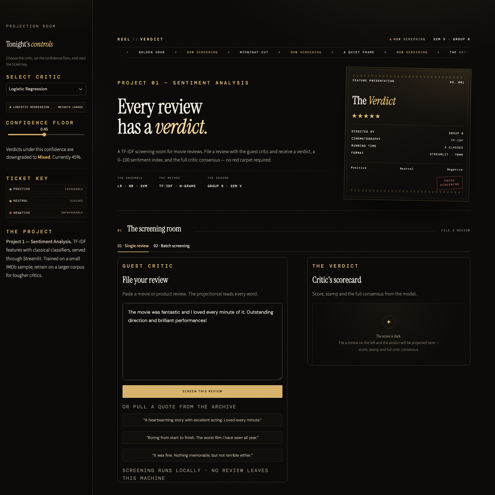
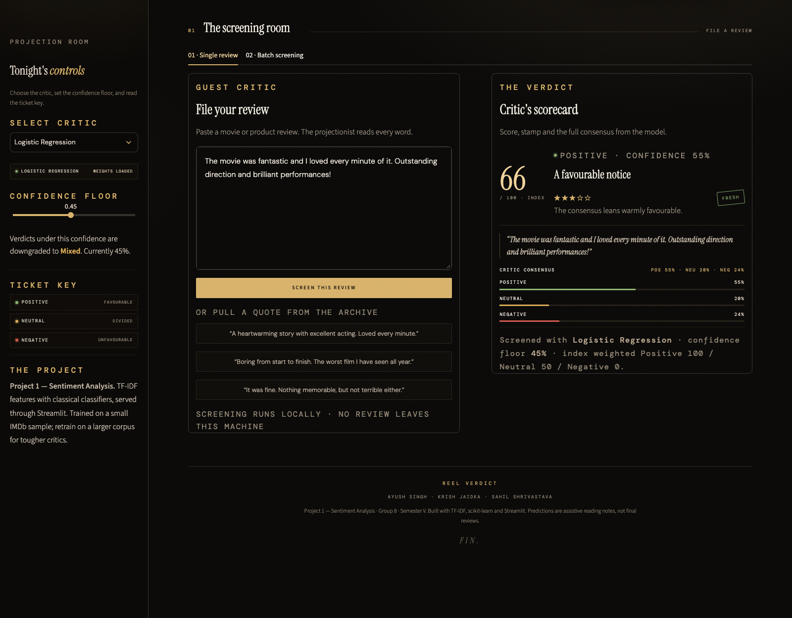
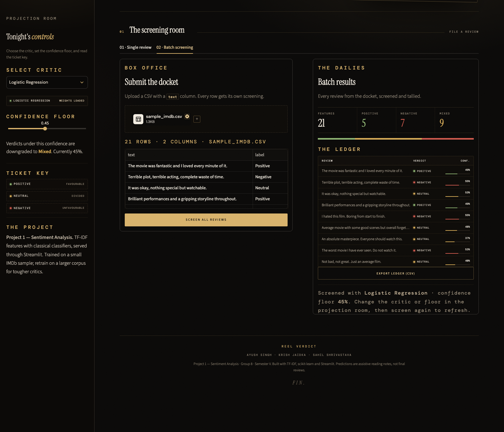
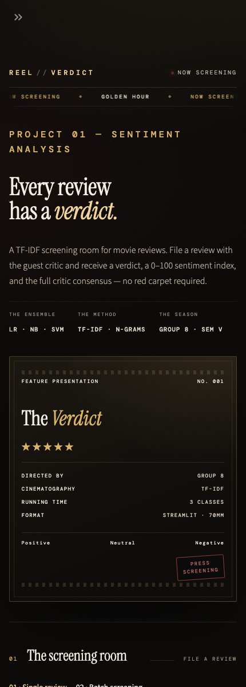

# 📊 Project Report – Project 1

## Sentiment Analysis

---

### Group 8 – NLP Capstone Project (Semester 5)

| Member | Roll No. |
|--------|----------|
| Ayush Singh | 2401730015 |
| Krish Jaidka | 2401730188 |
| Sahil Shrivastava | 2401730016 |

**Objective:** Classify text as Positive, Negative, or Neutral  
**Dataset:** IMDb Movie Reviews (suggested)  
**Model:** TF-IDF + Logistic Regression / Naive Bayes / SVM  
**Interface:** Streamlit Web Application — “Reel Verdict” cinematic theme  
**GitHub Repository:** https://github.com/apss2708/NLP-Project-Sem-5  
**Project Folder:** `Sentiment analysis/`

---

## 1. Abstract

This report presents **Sentiment Analyzer**, a machine learning-based sentiment classification system built as part of the NLP Capstone Project. The system accepts user-entered text (movie or product reviews) and predicts whether the sentiment is **Positive**, **Negative**, or **Neutral**, along with a confidence score. The pipeline uses TF-IDF vectorization for feature extraction and classical ML classifiers (Logistic Regression, Naive Bayes, Linear SVM) for prediction. A polished Streamlit GUI — branded **Reel Verdict** — provides a cinematic editorial interface for single-review analysis and batch CSV processing, with downloadable results. A rule-based keyword fallback ensures the application remains functional for demonstration even without trained model weights.

---

## 2. Problem Statement & Objectives

### 2.1 Problem Statement
Businesses and consumers generate vast amounts of textual feedback—movie reviews, product reviews, social media posts, and customer support tickets. Manually reading and classifying each piece of feedback for sentiment is impractical at scale. An automated sentiment analysis system helps organizations gauge public opinion, monitor brand reputation, and prioritize customer feedback efficiently.

### 2.2 Objectives
1. Collect and prepare a labelled sentiment dataset (movie/product reviews).
2. Clean and preprocess text (regex cleaning, tokenization, stopword removal).
3. Perform exploratory data analysis to understand sentiment distributions.
4. Convert text into numerical features using TF-IDF.
5. Train and compare ML classification models (Logistic Regression, Naive Bayes, SVM).
6. Evaluate performance using Accuracy, Precision, Recall, and F1-score.
7. Build a Streamlit GUI with single-review and batch-analysis capabilities.
8. Ensure the system is demonstrable via a rule-based fallback when model weights are unavailable.

---

## 3. Real-World Applications

- **Customer Support:** Automatically tag support tickets as positive/negative/neutral for prioritization.
- **Brand Monitoring:** Track sentiment of brand mentions across social media and review sites.
- **Product Development:** Analyze product reviews to identify strengths and weaknesses.
- **Market Research:** Gauge public reaction to new product launches or marketing campaigns.
- **Content Moderation:** Flag negative or toxic user-generated content for review.

---

## 4. Dataset Description

### 4.1 Source
A labelled sentiment dataset in CSV format was used. Each row contains a review text and its sentiment label.

**Suggested dataset:** IMDb Movie Reviews.

### 4.2 Format
```
text,label
"The movie was fantastic and I loved every minute of it.",Positive
"Terrible plot, terrible acting, complete waste of time.",Negative
"It was okay, nothing special but watchable.",Neutral
```

### 4.3 Sentiment Labels
| Label | Description |
|-------|-------------|
| Positive | Favorable, appreciative, recommending |
| Negative | Unfavorable, critical, discouraging |
| Neutral | Mixed, indifferent, factual without strong sentiment |

### 4.4 Sample Statistics
The included `sample_imdb.csv` contains 21 labelled reviews across Positive, Negative, and Neutral classes.

---

## 5. Data Preprocessing

### 5.1 Data Cleaning
- Lowercasing all text
- Removing HTML tags, URLs, and email addresses
- Removing punctuation and digits (keeping only alphabetic characters)
- Collapsing multiple whitespaces

### 5.2 Text Preprocessing
- **Tokenization:** Lightweight whitespace tokenization after cleaning
- **Stopword Removal:** Built-in English stopword list (no external downloads)
- **Length Filter:** Tokens of three letters or fewer are discarded after stopword removal
- **Pipeline:** Clean → Tokenize → Remove Stopwords → Rejoin

> The project uses only the Python standard library and scikit-learn for preprocessing, so the app works offline without NLTK corpus downloads.

---

## 6. Exploratory Data Analysis (EDA)

EDA is documented in `EDA.ipynb` and includes:

- Sentiment class distribution (count of Positive/Negative/Neutral reviews)
- Review length distribution (word count per review)
- Word clouds for each sentiment class
- Most frequent words per sentiment class

---

## 7. Feature Engineering

### 7.1 TF-IDF Vectorization
- **Vectorizer:** `TfidfVectorizer` from scikit-learn
- **Max Features:** 5,000 most important terms
- **N-gram Range:** (1, 2) — unigrams and bigrams to capture phrases
- **Output:** Sparse matrix of TF-IDF features ready for ML classifiers

### 7.2 Train/Test Split
- 80% training, 20% testing
- Stratified split to preserve class distribution
- Random state fixed for reproducibility

---

## 8. Methodology & Model Architecture

### 8.1 Pipeline Architecture
```
Input Text → Preprocessing → TF-IDF Vectorization → ML Classifier → Sentiment Prediction
```

### 8.2 Classifiers Compared
| Classifier | Description |
|------------|-------------|
| Logistic Regression | Linear probabilistic classifier, good baseline for text |
| Naive Bayes | Probabilistic classifier based on Bayes' theorem |
| Linear SVM | Support Vector Machine with linear kernel |

### 8.3 Training
- **Optimizer:** Default solver per classifier (liblinear/lbfgs for LR, SGD for SVM)
- **Max Iterations:** 1000 for Logistic Regression
- **Random State:** 42 for reproducibility

### 8.4 Model Selection
Logistic Regression is used as the default model due to its strong baseline performance on text classification tasks and interpretable coefficients.

---

## 9. Model Evaluation

Evaluation is performed on a held-out test set using scikit-learn metrics:

| Metric | Description |
|--------|-------------|
| Accuracy | Proportion of correct predictions |
| Precision | Proportion of predicted positives that are correct |
| Recall | Proportion of actual positives correctly identified |
| F1-Score | Harmonic mean of Precision and Recall |

Metrics are reported as weighted averages to account for class imbalance. A classification report and confusion matrix are also generated.

---

## 10. GUI Development (Streamlit)

### 10.1 Interface Overview

The GUI is branded **Reel Verdict** and uses a cinematic editorial design system: a warm near-black print, antique gold accents, serif display type, film-grain texture, a poster card, ticket stubs and a review scorecard. It is intentionally distinct from Project 16's BioNER Clinical theme so the two submissions do not look like the same product.

| Feature | Description |
|---------|-------------|
| Hero | Editorial masthead, film-ticker, and a “poster” card for the project |
| Critic Selector | Logistic Regression, Naive Bayes, SVM, or Rule-Based Demo |
| Engine Status | Shows whether trained weights loaded or the rule fallback is active |
| Confidence Floor | Functional slider: calls below the floor are downgraded to Mixed |
| Single Review Tab | Review desk with three one-click archive quotes |
| The Verdict | 0–100 sentiment index, star row, Fresh/Rotten/Mixed stamp, critic-consensus meters |
| Batch Tab | CSV upload, preview, tallies, proportional verdict bar, custom ledger, CSV export |
| Batch Persistence | Results survive reruns, including after a download click |
| Responsive Layout | Sidebar collapses on phones; poster, panels and tally grid stack cleanly |

### 10.2 Colour System
| Role | Colour | Hex |
|------|--------|-----|
| Print background | Near-black warm | `#0A0908` |
| Panel surface | Dark charcoal | `#12100D` |
| Primary accent | Antique gold | `#D9B36C` |
| Positive | Sage | `#8FB573` |
| Neutral | Amber | `#D8AC57` |
| Negative | Crimson | `#D15A4E` |
| Body text | Warm cream | `#F3EDE2` |

Gold buttons use near-black labels (not cream), preserving roughly 10:1 contrast. Muted micro-labels stay at full opacity and meet WCAG AA on the dark surfaces.

### 10.3 Rule-Based Fallback
If trained model weights are unavailable, the app uses a keyword-based rule engine with positive/negative word lexicons to classify sentiment. This ensures the GUI works for demonstrations even before training.

### 10.4 How to Run the GUI
```bash
cd "Sentiment analysis"
pip install -r requirements.txt
streamlit run app.py
```
Open **http://localhost:8501** in your browser.

### 10.5 Visual Identity and Separation from Project 16
The sibling BioNER project uses a clinical teal/light “studio” language. Sentiment Analysis instead uses:

- **Type:** Instrument Serif for display, DM Sans for body, DM Mono for micro-labels and scores
- **Colour:** warm black + antique gold, with sage/amber/crimson reserved for verdicts
- **Shape:** sharp 2–4 px corners, hairline borders, no white cards or pill badges
- **Motifs:** film grain, ticker, perforated poster, stamp, scorecard and ticket stubs
- **Voice:** “screening room”, “the verdict”, “critic consensus”, “dailies” — a review-site vocabulary rather than a lab dashboard

The visual system is implemented entirely in custom CSS inside `app.py`; no external UI kit or JavaScript is required.

### 10.6 Interface Screenshots

{width=70%}

{width=76%}

{width=82%}

{width=34%}

All screenshots are stored in the `screenshots/` folder.

---

## 11. Testing & Implementation

### 11.1 Manual Testing
| Test Input | Expected Sentiment |
|------------|-------------------|
| "The movie was fantastic and I loved it." | Positive |
| "Terrible plot, complete waste of time." | Negative |
| "It was okay, nothing special." | Neutral |
| Positive call below the confidence floor | Downgraded to Mixed, with footnote |
| Empty review + Screen button | Warning, no prediction |
| Archive quote button | Textarea updates; previous verdict clears |

### 11.2 Batch Testing
Upload a CSV with a `text` column to analyze multiple reviews at once. Results include tallies, a proportional verdict bar, a confidence-bar ledger, and a downloadable CSV. A confidence floor is applied to each row before the verdict is written.

---

## 12. Algorithms & Techniques Used

| Stage | Technique |
|-------|-----------|
| Data Collection | IMDb Movie Reviews / labelled corpus |
| Preprocessing | Regex cleaning, built-in stopwords, split tokenization |
| Feature Engineering | TF-IDF vectorization (unigrams + bigrams) |
| Model | Logistic Regression / Naive Bayes / Linear SVM |
| Evaluation | Accuracy, Precision, Recall, F1-score |
| GUI | Streamlit with custom CSS |

---

## 13. Limitations

1. **Small Sample Dataset:** The included `sample_imdb.csv` contains only 21 reviews. Real-world performance requires a larger corpus (e.g., full IMDb dataset with 50,000+ reviews).
2. **Model Weights Not Included:** Trained weights (`models/`) are gitignored. Users must run `python -m src.train_model` to generate them.
3. **English Only:** Currently supports English text.
4. **Rule-Based Fallback Accuracy:** The demo fallback uses keyword matching and is less accurate than trained ML models.
5. **No Sarcasm Detection:** Sarcastic or ironic reviews may be misclassified (common limitation in sentiment analysis).

---

## 14. Future Scope

- Train on full IMDb dataset (50,000+ reviews) for better accuracy
- Experiment with deep learning models (LSTM, BERT for sentiment)
- Add aspect-based sentiment analysis (e.g., sentiment about acting vs. plot separately)
- Deploy as a web application (Streamlit Cloud, Hugging Face Spaces)
- Add real-time social media stream analysis (Twitter API integration)
- Multi-language sentiment analysis support

---

## 15. Conclusion

Sentiment Analyzer demonstrates a complete NLP pipeline—from text preprocessing and TF-IDF feature engineering to ML classification and a user-friendly Streamlit GUI. The system classifies reviews as Positive, Negative, or Neutral with confidence scores, supporting both single-review and batch analysis. The **Reel Verdict** interface gives the project a distinct cinematic identity while keeping the model layer transparent: the sentiment index, critic-consensus meters, engine status and confidence floor all expose how a verdict was reached. The rule-based fallback ensures the application remains fully demonstrable for academic evaluation.

---

## 16. Team Contributions

All three group members contributed equally to both projects in Group 8:

- **Ayush Singh (2401730015):** Dataset collection, preprocessing, EDA notebook, model training, GUI development, documentation.
- **Krish Jaidka (2401730188):** Model architecture, training script, evaluation metrics, testing, GitHub setup.
- **Sahil Shrivastava (2401730016):** Streamlit UI design, CSS styling, rule-based fallback, screenshots, report writing.

---

## 17. References

1. Pang, B., & Lee, L. (2008). "Opinion Mining and Sentiment Analysis." *Foundations and Trends in Information Retrieval*.
2. Bird, S., et al. (2009). "Natural Language Processing with Python." O'Reilly.
3. Scikit-learn Documentation: https://scikit-learn.org
4. Streamlit Documentation: https://docs.streamlit.io

---

**Educational capstone project.** Model predictions are assistive, not medical or legal advice.
