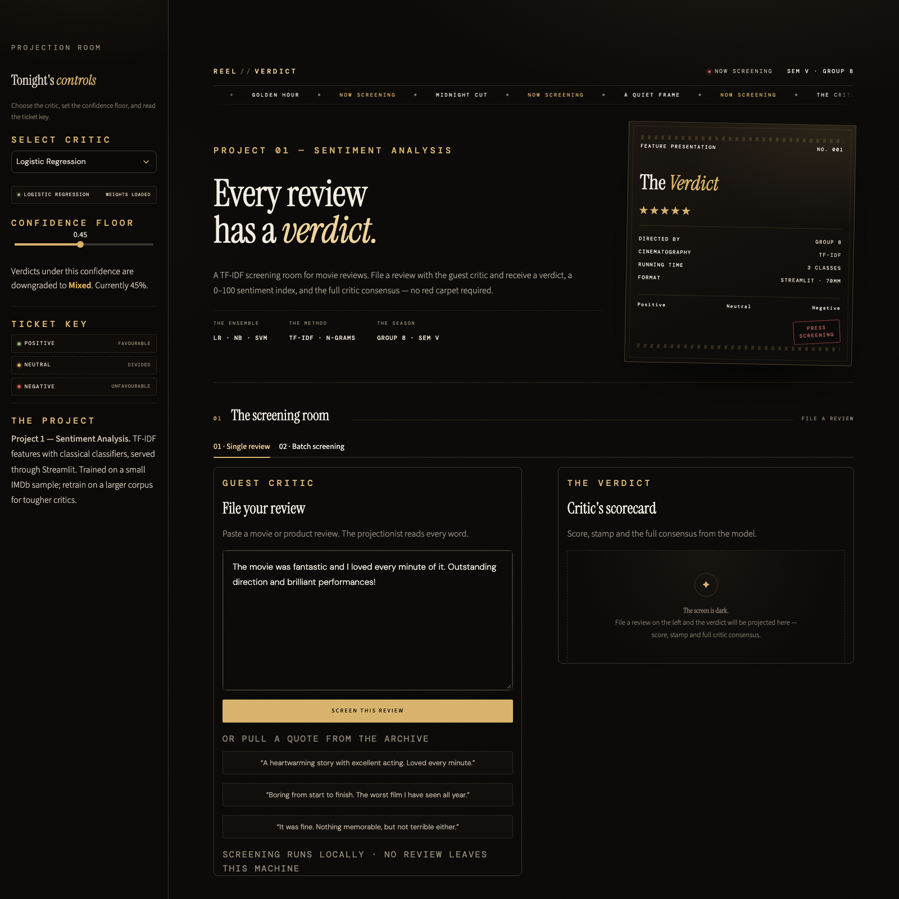
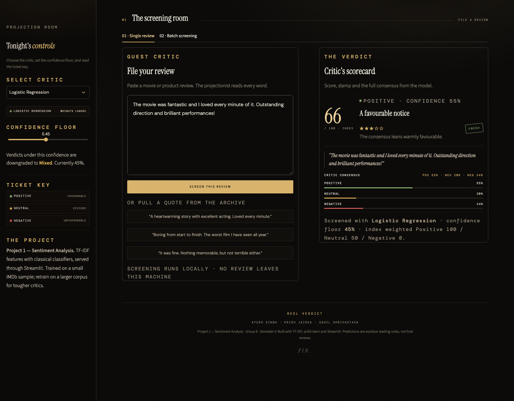
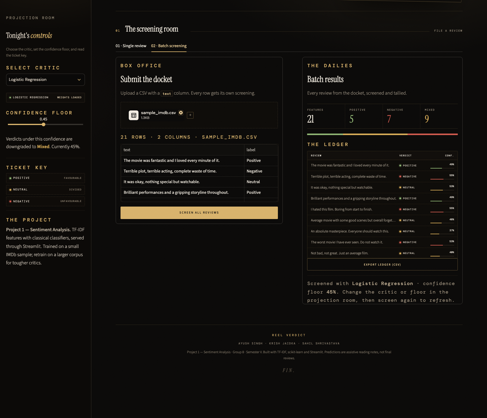
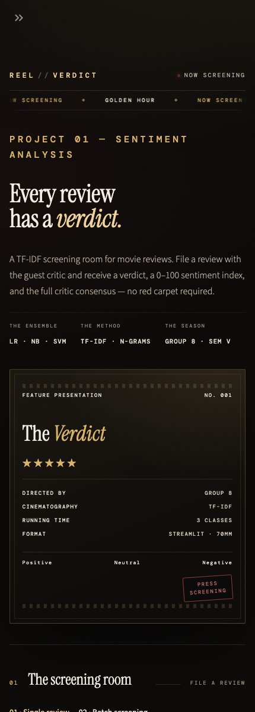

# 🎬 Project 1 – Sentiment Analysis

**Group 8**  
**Team Members:** Ayush Singh (2401730015) · Krish Jaidka (2401730188) · Sahil Shrivastava (2401730016)

**Objective:** Identify whether a given sentence, review, or feedback is Positive, Negative, or Neutral.  
**Model:** TF-IDF + ML (Logistic Regression, Naive Bayes, SVM)  
**GUI:** Streamlit — the **Reel Verdict** cinematic screening room  
**Dataset:** IMDb Movie Reviews (sample included; swap in the full corpus for stronger results)

---

## 📋 Project Overview

This project builds a Sentiment Analysis system that classifies text as Positive, Negative, or Neutral.

### What the system does
- Accepts raw text input (movie/product reviews) or a CSV of reviews
- Cleans text with regex (HTML, URLs, emails, punctuation and digits removed)
- Tokenizes with a lightweight split and removes stopwords using a built-in list — no NLTK downloads required
- Converts text into numerical features using TF-IDF (unigrams + bigrams)
- Trains and compares classical ML classifiers
- Predicts sentiment with confidence scores, a 0–100 sentiment index, and a confidence floor
- Falls back to a keyword-based critic when model weights are unavailable

### Supported Sentiment Classes
| Label | Meaning | Interface treatment |
|-------|---------|---------------------|
| Positive | Favorable review | Sage dot · **Fresh** stamp |
| Negative | Unfavorable review | Crimson dot · **Rotten** stamp |
| Neutral | Mixed or indifferent | Amber dot · **Mixed** stamp |

---

## 🎨 Visual Identity — “Reel Verdict”

This project deliberately uses a **different design system** from Project 16 (BioNER Clinical), so the two GUIs do not look like the same product.

| | Project 16 — BioNER Clinical | Project 1 — Reel Verdict |
|---|---|---|
| Mood | Clinical journal / lab instrument | Cinematic editorial / film print |
| Background | Porcelain paper (#F6F7F3) | Near-black warm print (#0A0908) |
| Accent | Deep petrol (#0B4F52) | Antique gold (#D9B36C) |
| Display type | Source Serif 4 | Instrument Serif |
| Body type | Public Sans + IBM Plex Mono micro-labels | DM Sans + DM Mono micro-labels |
| Motifs | Compliance strip, model card, protocol steps, finding ledger, audit metadata | Film grain, poster card, ticket stubs, scorecard, critic meters |

Everything is implemented with custom CSS in `app.py`; no external UI kit is required. The chosen cream/gold/muted colours meet WCAG AA contrast on the dark background, and buttons use near-black labels on gold rather than light-on-gold.

---

## 📁 Repository Structure

```
Sentiment analysis/
├── README.md                      # This file
├── requirements.txt               # Python dependencies
├── app.py                         # Streamlit GUI — Reel Verdict
├── .streamlit/
│   └── config.toml                # Dark cinematic theme tokens
├── .gitignore                     # Git ignore rules (models/ ignored, sample CSV kept)
├── src/
│   ├── __init__.py
│   ├── preprocess.py              # Regex cleaning, tokenization, built-in stopwords
│   ├── train_model.py             # TF-IDF + ML training pipeline
│   ├── evaluate.py                # Accuracy / Precision / Recall / F1
│   └── inference.py               # ML prediction (incl. SVM scores) + rule-based fallback
├── data/
│   ├── sample_imdb.csv            # 21 labelled sample reviews (included)
│   └── README.md                  # Dataset format instructions
├── models/                        # Trained weights (gitignored — retrain after clone)
├── EDA.ipynb                      # Exploratory Data Analysis notebook
├── Project_Report.md              # Full project report
└── screenshots/
    ├── hero.png                   # Opening-night hero + poster
    ├── single_review.png          # Verdict scorecard
    ├── batch_results.png          # Batch dailies ledger
    └── mobile.png                 # Responsive mobile layout
```

---

## 🚀 Setup & Installation

### 1. Clone the repository
```bash
git clone https://github.com/apss2708/NLP-Project-Sem-5.git
cd "NLP Project Sem 5/Sentiment analysis"
```

### 2. Create a virtual environment (recommended)
```bash
python3 -m venv venv
source venv/bin/activate      # Linux / macOS
venv\Scripts\activate         # Windows
```

> On macOS, use `python3` if `python` is not on your PATH.

### 3. Install dependencies
```bash
pip install -r requirements.txt
```

The app runs immediately without model weights thanks to the rule-based critic. To use the ML models, train them first (next section).

---

## 🛠️ How to Train the Model

```bash
python3 -m src.train_model
```

This will:
1. Load `data/sample_imdb.csv`
2. Clean the text, tokenize, and remove stopwords (built-in list, no downloads)
3. Split into train/test sets with stratification
4. Vectorize using TF-IDF (5,000 features, unigrams + bigrams)
5. Train Logistic Regression (the default critic)
6. Save the pipeline to `models/sentiment_logistic_regression.joblib`
7. Print evaluation metrics

To train a different classifier, call the trainer from Python:

```python
from src.train_model import train
train("naive_bayes")   # or "svm"
```

> **Note:** The bundled dataset contains only 21 reviews, so metrics are meant to demonstrate the pipeline, not production accuracy. Replace `data/sample_imdb.csv` with the full IMDb dataset (50,000 reviews) for meaningful performance.

---

## 🖥️ How to Run the GUI

```bash
streamlit run app.py
```

Then open **http://localhost:8501**.

### GUI Features

1. **Screening room — Single review**  
   Paste a review, or load one of three archive pull quotes. The verdict panel returns a 0–100 sentiment index, star rating, verdict stamp and the model's class probabilities as “critic consensus” meters.

2. **Confidence floor**  
   The sidebar slider is functional: any prediction below the floor is downgraded to **Mixed**, with a footnote explaining the underlying model call. Defaults to 45%.

3. **Critic selector**  
   Choose Logistic Regression, Naive Bayes, SVM or the Rule-Based Demo. The engine chip reports whether real weights were loaded or the fallback is active, so the interface never silently pretends.

4. **Batch screening — Box office dailies**  
   Upload a CSV with a `text` column. The app shows row/column counts, a preview, batch tallies, a proportional verdict bar, a custom ledger with per-row confidence bars, and a CSV export. Results persist across reruns, so downloading does not clear the ledger.

5. **Projection room sidebar**  
   Model controls, ticket key, and project notes in the same editorial language.

### Screenshots

#### Opening night


#### The verdict scorecard


#### Batch dailies


#### Mobile layout


---

## 📊 Evaluation

Run evaluation after training:

```bash
python3 -m src.evaluate
```

Reports:
- Accuracy, Precision, Recall, F1-score
- Per-class classification report
- Confusion matrix

---

## 📄 Dataset Format (CSV)

Each row contains a review and its sentiment label.

```csv
text,label
"The movie was fantastic and I loved every minute of it.",Positive
"Terrible plot, terrible acting, complete waste of time.",Negative
"It was okay, nothing special but watchable.",Neutral
```

**Required columns:** `text`, `label` (training); `text` only for batch prediction.

---

## 🧠 Algorithms & Techniques

| Stage | Technique |
|-------|-----------|
| Data Collection | IMDb Movie Reviews / labelled review corpus |
| Cleaning | Lowercase, HTML/URL/email removal, letters only, whitespace collapse |
| Preprocessing | Split tokenization, built-in English stopword removal, length filter |
| Feature Engineering | TF-IDF vectorization (unigrams + bigrams, 5,000 features) |
| Models | Logistic Regression / Multinomial Naive Bayes / Linear SVM |
| Training | Stratified train/test split, fixed random state |
| Evaluation | Accuracy, Precision, Recall, F1-score, Confusion Matrix |
| Inference | Trained pipeline (SVM scores normalised to probabilities) or keyword fallback |
| Interface | Streamlit + custom editorial CSS, Instrument Serif / DM Sans / DM Mono |

---

## ⚠️ Limitations

- The bundled 21-row sample is for demonstration; train on a larger corpus for real accuracy.
- Model weights are gitignored — retrain after cloning to use ML rather than the fallback.
- English-only preprocessing.
- Sarcasm and domain-specific slang remain difficult.
- Predictions are assistive reading notes, not definitive reviews.

---

## ✅ Submission Checklist

- [x] Complete source code uploaded to GitHub
- [x] `requirements.txt` included
- [x] `README.md` with setup & execution steps
- [x] Trained model folder (`models/`) or instructions to train
- [x] Screenshots of the working GUI
- [x] Jupyter notebook showing EDA and training
- [ ] PPT covering both group projects (Project 16 + Project 1)
- [ ] GitHub repository link submitted via Google Form

---

## 👥 Contributions

All three group members contributed equally:
- Dataset collection & preprocessing
- Model development & evaluation
- Streamlit GUI development & visual design
- Testing, documentation & GitHub deployment

---

**Educational capstone project.** Model predictions are assistive, not clinical or professional advice.
